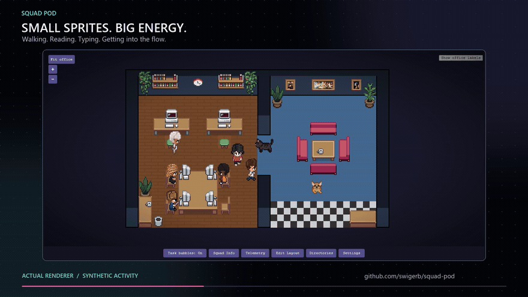

<p align="center">
  <picture>
    <source media="(prefers-color-scheme: dark)" srcset="https://raw.githubusercontent.com/swigerb/squad-pod/master/assets/squad-pod-logo-black.jpg" />
    
  </picture>
</p>

# Squad Pod

Your Squad AI team, brought to life in a pixel-art office. See who’s working, inspect your agents, and make the office your own.

[](https://raw.githubusercontent.com/swigerb/squad-pod/master/assets/showcase/Squad-Pod-Sizzle.mp4)

**[Watch the full 1:53 showcase (MP4)](https://raw.githubusercontent.com/swigerb/squad-pod/master/assets/showcase/Squad-Pod-Sizzle.mp4)** | [Captions (SRT)](assets/showcase/Squad-Pod-Sizzle.srt)

The showcase uses staged activity, not private session logs or customer data. See the [showcase credits](docs/user-guide.md#showcase-credits).

## Get started

1. Install [Squad Pod from Visual Studio Marketplace](https://marketplace.visualstudio.com/items?itemName=brianswiger.squad-pod), or run:

   ```powershell
   code --install-extension brianswiger.squad-pod
   ```

2. Open a project that has a [Squad](https://github.com/bradygaster/squad) team in `.squad/team.md`.
3. Run **Squad Pod: Show Panel** from the Command Palette, then click a character to inspect it.

Squad Pod needs VS Code 1.107 or later. You don't need Node.js or Copilot authentication to view the office.

## What you can do

- **Watch your team work.** Your roster loads from `.squad/team.md`, and characters walk, type, and read at their desks.
- **Inspect your agents.** Open roles, charters, models, and recent activity in Squad Info.
- **Follow live work.** Opt in to matching local Copilot CLI sessions for tool labels, task bubbles, and models.
- **Make the office yours.** Paint floors and walls, arrange furniture, create named Areas, and add pets or custom assets.
- **Keep your layouts.** Import and export JSON layouts, with recovery copies for conflicting edits.
- **Launch when you choose.** Save project directories and start `copilot --agent squad` in a new terminal.

## Settings

| Setting | Default | What it does |
|---|---|---|
| `squad-pod.liveActivity` | `false` | Reads matching local Copilot CLI session logs after you confirm consent. |
| `squad-pod.directorySuggestions` | `true` | Suggests recent Squad directories from session working-directory metadata. |
| `squad-pod.autoShowPanel` | `false` | Focuses the panel once when the extension activates. It never launches Squad. |

Sound notifications are in the office **Settings** panel, not in VS Code settings.

## Compatibility and privacy

Squad Pod is local-first. Basic observation reads your project's Squad files. Live activity is opt-in: enabling it asks for consent, then reads matching local Copilot CLI session logs. Recent-directory suggestions read only the working-directory field of session metadata; turn them off with the setting above.

Opening the panel never starts a task. Squad Pod submits `copilot --agent squad` only when you select **Launch**.

Read the full [compatibility and privacy notes](docs/user-guide.md#compatibility-and-privacy) and the [release scope](docs/testing.md#stable-10-release-scope).

## Learn more

- [User guide](docs/user-guide.md): editing, live activity, launching, usage and the [CLI import contract](docs/native-acceptance.md#cli-import-contract).
- [GitHub Copilot app preview](docs/canvas-install.md): the separate Canvas plugin for Windows, not GitHub Desktop.
- [Local browser observer](standalone/README.md): a source-only companion; see its [live activity opt-in](standalone/README.md#optional-live-activity).
- [Build and contribute](docs/contributing.md) and the [testing guide](docs/testing.md).

## Support, credits and license

Squad Pod is a personal open-source project by [Brian Swiger](https://www.mightybs.com/), not an official Microsoft or GitHub product. For questions, bugs, or feature requests, [open a GitHub issue](https://github.com/swigerb/squad-pod/issues).

Squad Pod is adapted from [Pixel Agents](https://github.com/pixel-agents-hq/pixel-agents) by [Pablo De Lucca](https://github.com/pablodelucca), and its character art builds on [JIK-A-4](https://jik-a-4.itch.io/metrocity-free-topdown-character-pack). See [THIRD_PARTY_NOTICES.md](THIRD_PARTY_NOTICES.md) for attribution and [Squad Pod and Pixel Agents](docs/user-guide.md#squad-pod-and-pixel-agents) for the comparison.

Squad Pod is released under the [MIT License](LICENSE).
